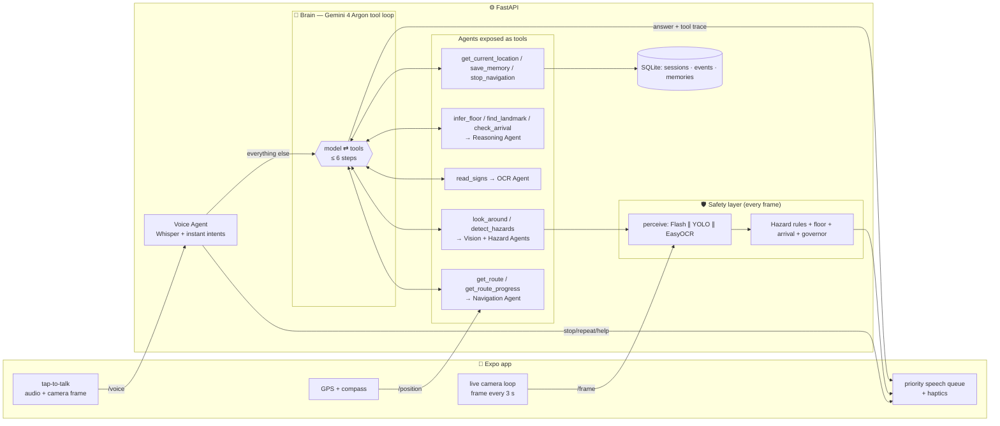
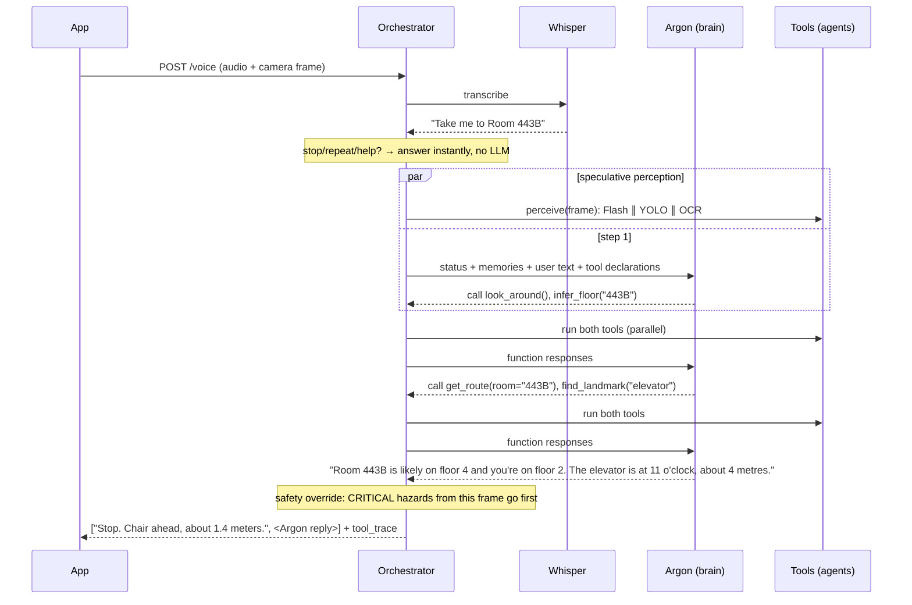
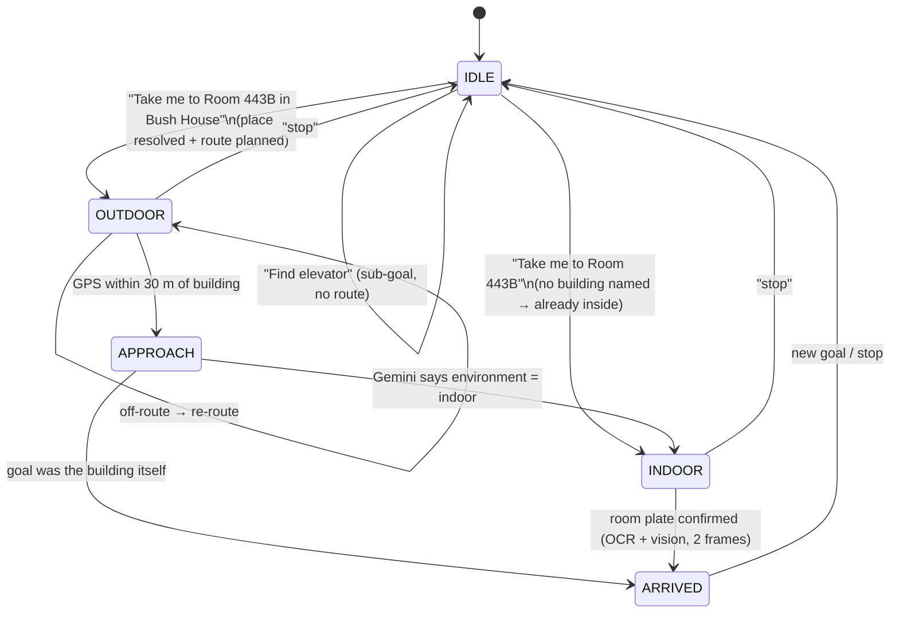
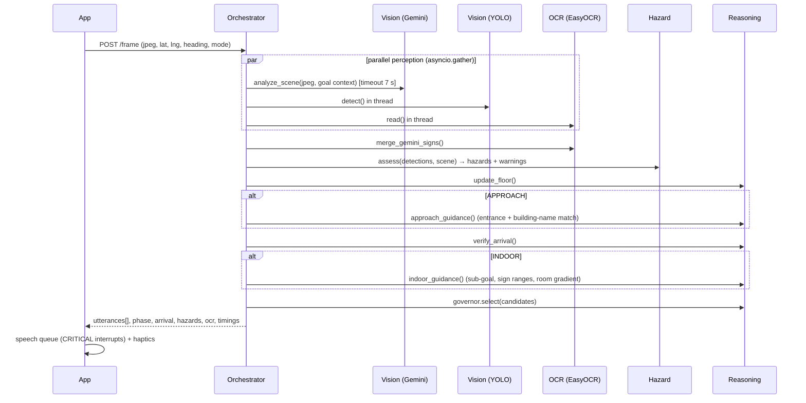

# VisionGuide — System Architecture

## 1. System overview: a brain and a safety layer

VisionGuide runs two layers that share the same agents:

| Layer | Model | Runs | Job |
|---|---|---|---|
| **Brain** | Gemini 4 Argon (`BRAIN_MODEL`), tool-calling | on each voice turn | Understands the request, decides which agents to call (as tools), reasons over the results, and phrases the answer. |
| **Safety layer** | Gemini Flash (`GEMINI_MODEL`) + YOLOv8n + EasyOCR + deterministic rules | every ~3 s, always | Hazards, floor signs, room plates, arrival. Speaks on its own and can interrupt. |

Why not let Argon do everything? Argon is Google's flagship deep-reasoning model for complex multi-step agents. It doesn't support the Live API, and every tool call is another round trip to the model, so a turn that calls three tools costs four model calls. That's the right trade for "Take me to Room 443B", and the wrong one for "Stop, chair ahead". Hazard warnings also can't depend on the model *choosing* to call `detect_hazards()`. So the brain plans and talks, the safety layer watches, and any critical hazard seen during a brain turn is spoken first, whatever the model wrote.



**Design principles**

| Principle | How it shows up |
|---|---|
| Safety first, then guidance, then description | Every utterance has a priority (CRITICAL › WARNING › GUIDANCE › INFO). Critical hazards interrupt speech and vibrate. |
| Don't flood a blind user with words | `SpeechGovernor`: max 2 utterances per frame, per-key cooldowns (10 s, hazards 4 s, scene 20 s), duplicate suppression. |
| Degrade, never die | Gemini timeout → YOLO + OCR still produce hazards. No Maps key → indoor mode still works. No torch → Gemini still reads signs. |
| Latency over depth | Gemini `thinking_budget=0`, YOLO at 480 px, three perception calls in parallel, on-device TTS. |
| Deterministic where it matters | Hazard severity, floor inference and arrival scoring are rules: testable, instant, and identical whether the brain is on or off. The LLMs do perception, planning and conversation. |

## 2. The six agents (and the tools they become)

In brain mode, each agent is reached through one or more tools:

| Tool (what Argon sees) | Backed by | Returns |
|---|---|---|
| `get_current_location()` | Navigation | GPS, address, heading, current floor, phase, destination |
| `get_route(place?, room?, sign_text?, target_kind?)` | Navigation + Reasoning | phase, place found, first steps, floor hint, sub-goal |
| `get_route_progress()` | Navigation | current/next instruction, distance and clock bearing to the goal |
| `look_around(focus?)` | Vision + Hazard + OCR | summary, landmarks (clock, metres), hazards, people, text, floor indicator |
| `detect_hazards()` | Hazard | fused hazards with severity, `path_clear` |
| `read_signs()` | OCR | text classified as room / floor / gate / building / direction |
| `infer_floor(room)` | Reasoning | likely floor, confidence, whether a floor change is needed |
| `find_landmark(kind)` | Reasoning | visible now? clock/distance; sets a sub-goal the safety layer keeps announcing |
| `check_arrival()` | Reasoning | searching / candidate / confirmed + evidence |
| `save_memory(key, value)` | DB | "office = Room 443B in Bush House", "prefers stairs" |
| `stop_navigation()` | Orchestrator | — |

The camera frame captured with the voice command is analysed **speculatively in parallel with Argon's first step**. By the time Argon calls `look_around()`, the result is usually ready. Memories and a status snapshot go into every prompt, so "take me to my office" works without an extra tool call.


| Agent | File | Responsibilities | Inputs → Outputs |
|---|---|---|---|
| **Navigation** | `agents/navigation_agent.py` | Resolve destination with Places API (New); walking route with Routes API (`computeRoutes`, `WALK`); track GPS; advance steps; pre-announce turns at 35 m; detect off-route (>45 m from polyline) and re-route; hand off to entrance search within 30 m; clock-face bearing to target | GPS fix, heading → turn instructions, phase change OUTDOOR→APPROACH |
| **Vision** | `agents/vision_agent.py` | One structured Gemini call per frame conditioned on the user's goal (landmarks, hazards, sign transcriptions, floor indicator, "is destination visible?"); YOLOv8n for metric-ish boxes; maps image x-position → clock direction; pinhole distance estimate from box height | JPEG → `SceneAnalysis` + `Detection[]` |
| **OCR** | `agents/ocr_agent.py` | EasyOCR for text with bounding boxes; merge Gemini sign transcriptions; classify each string as `room` / `floor` / `gate` / `building` / `direction` / `other`; parse room ranges and arrows ("Rooms 440–460 →") | image → `OCRText[]` |
| **Hazard** | `agents/hazard_agent.py` | Fuse YOLO objects with Gemini hazards (YOLO geometry + Gemini semantics); canonicalise types (wet floor, stairs, open door, construction barrier, curb, uneven surface, chair, vehicle…); severity from type × position × distance; people counting ("Two people ahead") | detections + scene → `Hazard[]`, warnings |
| **Voice** | `agents/voice_agent.py` | Whisper STT with a vocabulary prompt (room codes, "elevator", "reception"); rule-based intent parser for navigate / find / where_am_i / describe / read_text / repeat / stop / help; destination parsing ("Room 443B in Bush House" → room + place); saved places ("take me to work"); everything else → assistant | audio/text → `Intent` |
| **Reasoning** | `agents/reasoning_agent.py` | Floor reasoning (443B → floor 4; elevator display → current floor; nearby room plates → current floor); sub-goal planning (wrong floor → find elevator); indoor wayfinding (sign ranges, room numbers getting closer/further, wrong-suffix detection); entrance verification (OCR building name vs Places name); arrival verification (multi-frame evidence scoring); speech governance; conversational assistant over the fused world state | everything → decisions + `Utterance[]` |

The **Orchestrator** (`agents/orchestrator.py`) owns session state and the phase machine, runs the agents for each incoming event, and persists state and events.

### A brain turn, step by step



Guard rails around the model:
- **Step cap** (`BRAIN_MAX_STEPS=6`) and an overall timeout (`BRAIN_TIMEOUT_S=25`). On either, a model error, or no Gemini key, the turn falls back to the rule-based dispatcher, so the user always gets an answer.
- **Thought signatures:** the model's own turn is echoed back unchanged with the function responses, as Gemini 3+ requires for multi-step tool use.
- **Tool errors** are returned to the model as `{"error": ...}` instead of ending the turn.
- **`AGENT_MODE=rules`** turns the brain off entirely, which is useful for offline demos or cost control.

## 3. Phase machine



Sub-goals (`session.subgoal`) layer on top of the phase: when floor reasoning finds you're on floor 2 and the room is on floor 4, the subgoal becomes `elevator`. It clears automatically once a floor sign confirms floor 4.

## 4. Orchestration of one camera frame



**Typical latency budget** (estimates for planning; measure your own with the `timings_ms` field):

| Stage | Typical | Notes |
|---|---|---|
| Capture + resize on phone | 150–300 ms | `takePictureAsync` + `ImageManipulator` to 960 px |
| Upload ~120 KB over Wi-Fi | 100–300 ms | |
| Gemini Flash, image + JSON | 1–2.5 s | minimal thinking; dominates the tick |
| YOLOv8n CPU @480 | 50–150 ms | runs in parallel |
| EasyOCR CPU | 0.4–1.5 s | runs in parallel; GPU or `ENABLE_OCR=false` if slow |
| Reasoning + governor | < 5 ms | pure Python |
| *Brain turn (voice only)* | *one Argon call per step, typically 2–4 steps* | *not on the safety path; measure with `tool_trace`* |
| On-device TTS start | < 100 ms | |

So a frame is spoken about 2–3 s after capture. That's fine for wayfinding, but **too slow for collision avoidance on its own**: the user still uses their cane or guide dog, and the demo should say so. YOLO-only fast paths (sub-second) are a natural next step (see §8).

## 5. Arrival verification logic

```
score = 0
room goal:   best OCR room match  m ∈ {1.0 exact, 0.9 "4438" for "443B", ...} × (0.7 + 0.3 × ocr_confidence)
sign goal:   fuzzy_contains(ocr_text, "Gate 4") × (0.7 + 0.3 × conf)
target goal: landmark of that kind within 2.5 m → 0.9
Gemini destination_visible → +0.15 (or 0.6 if nothing else)

candidate  if score ≥ 0.6         → "I think I see Room 443B at 1 o'clock. Move a little closer."
confirmed  if score ≥ 0.95 or two consecutive candidate frames → "You have arrived at Room 443B." + success haptic
wrong room if same number, different suffix (443A vs 443B) → "This is Room 443A, not 443B. It should be right next to it."
```

## 6. Floor reasoning rules (`utils/floor.py`)

| Seen | Inference |
|---|---|
| `443B`, `205A`, `312` | first digit = floor (4, 2, 3) |
| `1205` | first two digits = floor 12 |
| `B105` | wing B, floor 1 |
| `G12`, `G.05` | ground floor (UK) |
| `Level 3`, `Floor 2`, `L2`, `4F`, `3rd floor`, `second floor` | explicit floor |
| `G`, `Ground`, `Lobby` / `LG`, `B1`, `Basement` | 0 / below ground |
| elevator display "2" (via Gemini `floor_indicator`) | floor 2 |
| several room plates all in the 200s | "probably floor 2, based on the room numbers around you" |

## 7. Database schema (SQLite)

```sql
CREATE TABLE sessions (
    id          TEXT PRIMARY KEY,      -- 12-char hex
    created_at  REAL NOT NULL,
    updated_at  REAL NOT NULL,
    phase       TEXT NOT NULL,         -- idle|outdoor|approach|indoor|arrived
    destination TEXT,                  -- JSON Destination
    state_json  TEXT NOT NULL          -- full SessionState snapshot (route, floor, last scene, cooldowns…)
);
CREATE TABLE events (
    id          INTEGER PRIMARY KEY AUTOINCREMENT,
    session_id  TEXT NOT NULL REFERENCES sessions(id) ON DELETE CASCADE,
    ts          REAL NOT NULL,
    kind        TEXT NOT NULL,         -- command|utterance|route|frame|...
    payload     TEXT NOT NULL          -- JSON
);
CREATE INDEX idx_events_session_ts ON events(session_id, ts);
CREATE TABLE memories (                -- written by the brain's save_memory tool
    key         TEXT PRIMARY KEY,      -- "office"
    value       TEXT NOT NULL,         -- "Room 443B in Bush House"
    updated_at  REAL NOT NULL
);
CREATE TABLE saved_places (
    id          INTEGER PRIMARY KEY AUTOINCREMENT,
    label       TEXT UNIQUE NOT NULL,  -- "work"
    query       TEXT NOT NULL,         -- "Bush House, London"
    room        TEXT,                  -- "443B"
    created_at  REAL NOT NULL
);
```

Hot state lives in memory (`SessionStore`); each change is snapshotted so a backend restart mid-demo keeps the user's goal. `events` gives a replayable log (`GET /v1/sessions/{id}/events`) for judges. No images are stored.

Swap to Postgres later by replacing `db.py`; the JSON-snapshot pattern maps directly to a `jsonb` column.

## 8. Key decisions and trade-offs

- **Routes API instead of the legacy Directions API.** Google moved the Directions API and the old Places API to *Legacy* on 1 March 2025, and legacy services can't be enabled on new Cloud projects. `computeRoutes` with `travelMode: WALK` is the drop-in successor. Set `USE_LEGACY_DIRECTIONS=true` only if your project already has the old API enabled; the code supports both.
- **On-device TTS (expo-speech).** Zero network latency, works offline, respects the user's system voice. When VoiceOver/TalkBack is on, the app announces through the screen reader instead, so the user keeps their own voice and rate.
- **YOLO + Gemini, not one or the other.** YOLO gives fast, consistent boxes for COCO objects (people, chairs, bikes, cars) and a distance estimate. Gemini covers the open vocabulary YOLO can't see: wet floors, stairs, open doors, entrances, reception desks, sign text. The Hazard Agent fuses them.
- **EasyOCR + Gemini sign reading.** EasyOCR gives bounding boxes, so we know *where* the "443B" plate is (clock direction). Gemini reads stylised or angled text better. The two are merged and de-duplicated.
- **Argon for reasoning, Flash for perception.** Argon (tool-calling, thinking level `low` by default) handles the turns that need judgement: multi-step planning, memory, ambiguous requests. The per-frame loop uses a Flash model with minimal thinking and structured JSON output, because it runs every 3 seconds. Both are configurable (`BRAIN_MODEL`, `GEMINI_MODEL`).
- **Instant intents bypass the model.** "Stop", "repeat" and "help" are matched by regex in under 1 ms and never wait on an LLM. In `rules` mode the same parser handles every command.
- **Polling, not WebSockets.** HTTP request-per-frame is simpler to build and debug in 5 hours, and the frame cadence (3 s) doesn't need streaming. A WebSocket upgrade is a contained change in `useSceneLoop` and one new endpoint.

**Next steps after the hackathon:** move voice to the Gemini Live API (`gemini-3.8-live`, low-latency audio with asynchronous function calling) and keep Argon as a planner it can call; on-device YOLO (TFLite/CoreML) for sub-200 ms obstacle alerts; Gemini Live API for streaming video; indoor maps (IMDF / venue floor plans) where available; bone-conduction headphone support; user testing with blind participants and orientation-and-mobility instructors.
